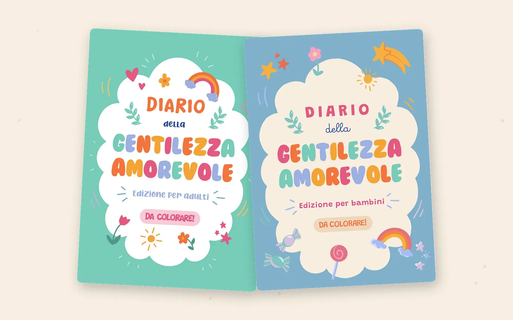
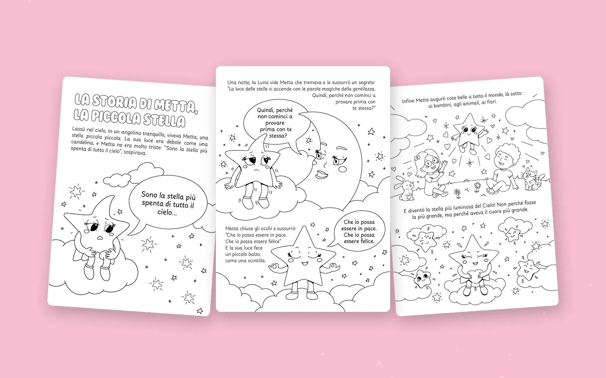

## Nessuno ce l'ha insegnato

Ci hanno insegnato tantissime cose.

Le tabelline. Ad allacciarci le scarpe. A dire grazie e per favore, a non parlare con la bocca piena.

Ma nessuno, in nessuna classe, ci ha mai messo davanti a uno specchio per dirci: adesso impara a volerti bene.

E così siamo cresciuti bravissimi a trovarci difetti. Esperti di "potevo fare meglio". Campioni olimpici di "non sono abbastanza".

Io ho dovuto impararlo da grande, l'amore verso me stessa. Piano, un respiro alla volta, come si impara una lingua straniera che però, scopri dopo, era la tua lingua madre.

## Un augurio sussurrato

La metta, la gentilezza amorevole, è una pratica antica di duemilacinquecento anni. Ed è di una semplicità quasi imbarazzante.

Ti siedi. Chiudi gli occhi. E auguri del bene.

> Che tu possa essere felice. 
> Che tu possa essere in pace. 
> Che tu possa essere libero dalla sofferenza.

Lo auguri prima a te, come si rimbocca la coperta a un bambino che ha paura del buio. Poi a chi ami. Poi a qualcuno che conosci appena, il panettiere, la vicina del terzo piano. Poi, un giorno, a chi ti ha ferito. E alla fine a tutti, proprio tutti.

Non è una formula magica. È un allenamento. Perché l'amore non è solo qualcosa che ti capita: è qualcosa che si allena, come un muscolo che avevi dimenticato di avere.

## Due diari, uno grande e uno piccolo

Per questo ho scritto due diari di pratica Metta.

Uno è per gli adulti: un posto dove fermarsi, scrivere, accorgersi di come cambia il cuore pagina dopo pagina.

L'altro è per i bambini dai 6 anni in su, ed è un diario da vivere. Ci sono disegni da colorare, esercizi da fare, pagine bianche da riempire con la propria calligrafia storta e bellissima. I più piccoli possono usarlo insieme a mamma e papà.

Perché nessun bambino dovrebbe crescere senza sapere che l'amore si impara. E nessun adulto dovrebbe smettere di impararlo.

## Il rituale di famiglia

Immagina la sera. I piatti ancora nel lavello, le luci basse, la giornata che finalmente si siede.

Tu apri il tuo diario. Tuo figlio apre il suo. Cinque minuti, non di più.

Poi vi guardate e vi dite una cosa sola: a chi avete augurato del bene oggi.

Magari lui dice "alla maestra". Magari dice "al mio compagno che oggi mi ha spinto". E tu resti lì, con il cuore in gola, perché un bambino di sette anni ti ha appena insegnato il perdono senza saperlo.

Non serve un tempio. Basta un tavolo di cucina. Il rituale non è la cosa straordinaria che fate una volta: è la cosa piccola che fate insieme ogni giorno. Ed è quella che i figli si porteranno dietro quando saranno grandi, e noi non ci saremo a ricordargliela.

## Fino a chi non vedi

E poi la metta esce di casa.

Arriva all'uomo che dorme sotto i portici della stazione, quello che abbiamo imparato a non guardare. Arriva alla madre che in questo momento, dall'altra parte del mare, stringe un figlio e non sa se domani avranno da mangiare. Arriva alla persona sola in un ospedale, che nessuno è andato a trovare.

Non li vedrai mai. Non sapranno mai il tuo nome.

Eppure, quando sussurri *che tu possa essere in pace* a qualcuno che non vedi, succede una cosa strana: smetti di sentirti separato.

Perché la verità, quella che la metta ti fa scoprire piano piano, è che la separazione era un'illusione.

> Io sono te. 
> Tu sei me.

Il dolore di quella madre lontana è lo stesso dolore che ho conosciuto io. La sua speranza è la mia.

Non possiamo salvare tutti. Ma possiamo smettere di voltarci dall'altra parte. E un cuore che ha smesso di voltarsi, prima o poi, si mette in cammino.

## Si comincia da sé

Il mondo non ha bisogno di persone perfette.

Ha bisogno di persone gentili. Di persone che si abbracciano dentro prima di abbracciare fuori.

E quell'abbraccio, lo giuro, non si ferma mai a una persona sola. Passa da te a tuo figlio, da tuo figlio al suo compagno di banco, dal compagno di banco a sua madre, e così via, fino a qualcuno che non incontrerai mai. Perché non c'è separazione. Non c'è mai stata.

<strong>I diari Metta sono disponibili su Amazon</strong>

Diario della Gentilezza Amorevole – Edizione per adulti

Diario della Gentilezza Amorevole – Edizione per bambini

Intanto, chiudi gli occhi un attimo.

Che tu possa essere felice.

Sì, dico proprio a te che stai leggendo.

Silvia Genevro

